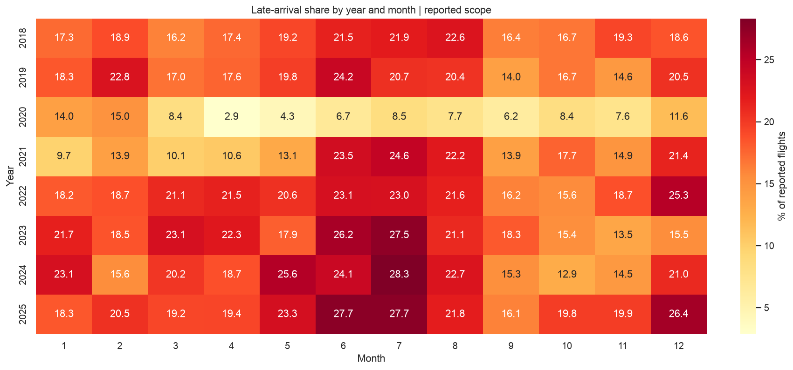

# Airline Operations & Delay Analytics

**A complete Python data analytics capstone built around official BTS data and the supplied airline problem statement.**

Analyze operational performance, audit the data, visualize delay exposure, test a seasonal difference, predict monthly segment rates, and evaluate time-series forecasts on later periods. The project works locally without a GitHub login.

## Start here

- **[Executive report — open in a browser](reports/executive_report.html)**: results, 11 charts and the full audit, embedded in one HTML file.
- **[Executed Python notebook](notebooks/airline_delay_analysis.ipynb)**: all 10 project phases, code, outputs and interpretation.
- **[Read-only notebook HTML](reports/notebook.html)**: no Python required to read it.
- **[Complete explanation and viva guide](docs/EXPLANATION_GUIDE.md)**.
- [Assignment coverage checklist](docs/ASSIGNMENT_COVERAGE.md).

The core course workflow through hypothesis testing is in notebook Phases 1–6. Prediction, forecasting and final decision analysis complete Phases 7–10.



## Run locally

Use Python 3.11 or later. Unzip the project, open a terminal in this directory, then:

```bash
python3 -m venv .venv
source .venv/bin/activate
# Windows: .venv\Scripts\activate
python -m pip install -r requirements.txt
python -m jupyterlab notebooks/airline_delay_analysis.ipynb
```

Select the environment's Python kernel and **Run → Run All Cells**. The bundled original ZIP lets analysis run offline after dependency installation. On a fresh clone, source verification restores the original CSV byte-for-byte from the ZIP and verifies its recorded hash. The large cleaned CSV is generated locally by the analysis pipeline rather than stored in GitHub. The notebook can be launched from the root or notebooks folder. Running the full analysis may take a few minutes.

To reproduce without the notebook interface:

```bash
python -m src.analysis
python -m unittest discover -s tests -v
python scripts/execute_notebook.py
```

The first command verifies raw hashes and rebuilds cleaned data, audit, KPIs, statistical test, models, forecasts, SQL outputs, figures and reports. The second runs validation checks. The third executes and exports the notebook with the current Python environment, using a temporary uniquely named kernel registration that is removed afterward.

`requirements.txt` provides version ranges for installation across Python versions. `requirements-lock.txt` records the exact tested Python 3.14/macOS environment; it is an environment record and may not resolve unchanged on other platforms. Only requirements installation needs internet; the bundled dataset is sufficient for all subsequent analysis.

## Dataset and scope

Official source: [BTS Airline On-Time Statistics and Delay Causes](https://www.transtats.bts.gov/OT_Delay/OT_DelayCause1.asp). Requested all carriers and airports for **January 2018–December 2025**, downloaded **3 November 2026**. Exact server archive filename, URL, byte sizes and SHA-256 hashes are in [provenance.json](data/raw/provenance.json). The original CSV and ZIP are unchanged; no other dataset was substituted or joined. The ZIP preserves the source's original column-definition workbook as well.

- Raw: **186,371 rows × 21 fields**.
- Analytical grain: **month × carrier × arrival airport**.
- Clean: **186,049 records**, excluding 322 with missing required operational quantities.
- 250 missing delayed counts are derived as zero only under documented all-cancelled/diverted, zero-delay evidence.
- The downloaded data describe aggregate airline operations. Satisfaction, route origins, aircraft identities and passenger attributes are absent and not manufactured.

This is a dated snapshot, not an immutable BTS release. `scripts/download_data.py` can re-fetch the official request and compare it with the original snapshot; source revisions must be audited separately. The raw archive includes no dataset-specific license identifier; preserve source attribution and do not apply the code license to the source data. See [dictionary and source conditions](docs/DATA_DICTIONARY.md).

## Methods and main results

| Component | Design | Calculated result |
|---|---|---|
| Descriptive KPIs | Ratio of summed counts, 2018–2025 clean scope | 56,850,634 reported flights; 18.74% late-arrival share |
| Hypothesis test | Paired summer/autumn rates at 30 previously selected major airports, 2023–2025 | Summer minus autumn about 8.93 percentage points; exact CI/p-value in notebook |
| Segment prediction | Train through Sep 2023, validate Jan–Sep 2024, refit through Sep 2024, test 2025; exact historical lags | Flight-weighted MAE 5.98 pp baseline vs 4.59 pp candidate |
| National forecast | Fixed origin with three-month publication gap; 2023 validation, 2025 test | RMSE 4.54 pp seasonal naive vs 2.60 pp ETS |

The prediction target is an aggregate monthly delay share, not an individual flight classification. Model error improvement does not mean actual flight delays were reduced. Forecast bands are illustrative validation-error ranges; the study does not guarantee future coverage. Observational associations and operational attribution are not causal effects.

## Deliverables

```text
data/raw/          Unchanged original CSV + ZIP, provenance and hashes
data/processed/    Deterministically cleaned analytical table
notebooks/         Executed 10-phase Python notebook
src/               Analysis functions and generated reporting
scripts/           Notebook build/execute, official re-download comparison
reports/           Audit, KPIs, 11 charts, test/model/forecast outputs, HTML reports
docs/              Business framing, dictionary, KPIs, dashboard spec, explanation
sql/               SQLite-compatible analytical queries
tests/             Source, denominator, lag-alignment and reconciliation checks
```

## Responsible interpretation

No passenger identifiers or credentials are included. Missingness is profiled; outliers and pandemic months are retained. Only calendar variables and exact t-3/t-12 historical quantities enter prediction. Reporting release vintages are unavailable, so publication-lag protection is an approximation. Carrier-airport segments without sufficient history have unknown cold-start performance. The paired test has approximate independence and purposive-sample limitations. All results are specific to the downloaded reporting scope and time period.

Read [findings](reports/findings.md) and [audit](reports/audit.md) before presenting. This project was prepared with AI assistance; rerun it, understand the methods, and follow institution attribution requirements. No student name or institution has been invented.

## GitHub repository

Repository: [Mahaaa-cmd/airline-delay-analytics](https://github.com/Mahaaa-cmd/airline-delay-analytics). The unchanged source ZIP is versioned; its redundant uncompressed CSV and the large generated cleaned table are ignored. Source verification restores the original CSV, and the pipeline recreates the full cleaned table. No network download or API key is needed for analysis after dependency installation.

Project code: MIT license. Source data: separate BTS provenance and conditions documented above.
